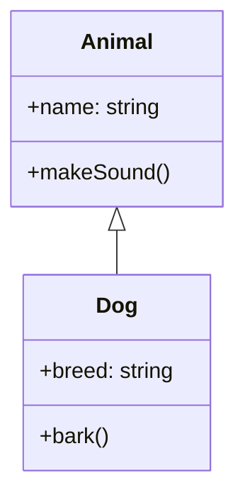

# Mermaid Diagram Support for p5.js Website

This implementation adds build-time Mermaid diagram rendering to the p5.js website, addressing [Issue #168](https://github.com/processing/p5.js-website/issues/168).

## Problem

Mermaid diagrams in MDX files (like the WebGL architecture class diagram in `webgl_mode_architecture.mdx`) render correctly on GitHub but display as raw code blocks on the p5.js website.

## Solution

A custom **remark plugin** that:
1. Processes Mermaid code blocks during MDX compilation
2. Renders diagrams to SVG at build time (no client-side JS needed)
3. Generates both light and dark themed versions
4. Uses CSS to toggle visibility based on the site's theme

## Key Features

- **Build-time rendering** - No client-side JavaScript required
- **Theme support** - Automatic light/dark mode switching
- **No source modifications** - Works with auto-generated MDX files
- **Accessible** - SVGs include proper ARIA attributes
- **Responsive** - Diagrams scale appropriately on all devices

## Installation

### Step 1: Install Dependencies

Add these packages to the p5.js-website project:

```bash
npm install mermaid jsdom unist-util-visit rehype-raw
```

### Step 2: Copy Plugin Files

Copy the following files to the p5.js-website repository:

```
src/plugins/remark-mermaid.mjs  →  p5.js-website/src/plugins/remark-mermaid.mjs
src/styles/mermaid.scss        →  p5.js-website/src/styles/mermaid.scss
```

### Step 3: Update Astro Configuration

Modify `astro.config.mjs` to include the plugin:

```javascript
import { remarkMermaid } from './src/plugins/remark-mermaid.mjs';
import rehypeRaw from 'rehype-raw';

export default defineConfig({
  markdown: {
    remarkPlugins: [remarkMermaid],
    rehypePlugins: [rehypeRaw],
  },
  integrations: [
    mdx({
      remarkPlugins: [remarkMermaid],
      rehypePlugins: [rehypeRaw],
    }),
    // ... other integrations
  ],
});
```

### Step 4: Import Styles

Add the Mermaid styles to your global stylesheet or import them in your layout:

```scss
// In your main SCSS file
@import './styles/mermaid.scss';
```

Or in an Astro layout:

```astro
---
// In your Layout.astro
import '../styles/mermaid.scss';
---
```

### Step 5: Configure Theme Detection

The CSS supports multiple theme detection methods. Ensure your site uses one of these:

**Option A: Data attribute (recommended)**
```html
<html data-theme="dark">
```

**Option B: Class on html/body**
```html
<html class="dark">
```

**Option C: System preference** (uncomment in mermaid.scss)
```scss
@media (prefers-color-scheme: dark) { ... }
```

## Usage

Once installed, any Mermaid code block in MDX files will automatically render:

````markdown

````

This will be rendered as an SVG diagram at build time.

## Test Case

The primary test case is the WebGL architecture diagram in:
```
src/content/contributor-docs/en/webgl_mode_architecture.mdx
```

After integration, the class diagram showing `p5.Renderer`, `p5.RendererGL`, `p5.Geometry`, etc. should render visually instead of showing raw Mermaid code.

## How It Works

### Build Process

1. **Parse**: The remark plugin visits all `code` nodes with `lang="mermaid"`
2. **Render**: Each diagram is rendered twice using Mermaid's API:
   - Light theme (`theme: 'default'`)
   - Dark theme (`theme: 'dark'`)
3. **Replace**: The code block is replaced with HTML containing both SVG versions
4. **Output**: The final HTML includes both diagrams in a wrapper

### Theme Switching

```html
<figure class="mermaid-diagram">
  <div class="mermaid-light"><!-- Light SVG --></div>
  <div class="mermaid-dark"><!-- Dark SVG --></div>
</figure>
```

CSS toggles visibility:
- Light theme: `.mermaid-light` visible, `.mermaid-dark` hidden
- Dark theme: `.mermaid-light` hidden, `.mermaid-dark` visible

## File Structure

```
p5js-mermaid-support/
├── README.md                       # This file
├── package.json                    # Dependencies
├── astro.config.example.mjs        # Example Astro configuration
└── src/
    ├── plugins/
    │   └── remark-mermaid.mjs      # The remark plugin
    └── styles/
        └── mermaid.scss            # Theme-aware CSS
```

## Dependencies

| Package | Version | Purpose |
|---------|---------|---------|
| `mermaid` | ^10.9.0 | Diagram rendering engine |
| `jsdom` | ^24.0.0 | DOM environment for Node.js |
| `unist-util-visit` | ^5.0.0 | AST traversal utility |
| `rehype-raw` | ^7.0.0 | Preserve raw HTML in output |

## Troubleshooting

### Diagrams not rendering

1. Check that `remarkMermaid` is added to both `markdown.remarkPlugins` and `mdx.remarkPlugins`
2. Ensure `rehype-raw` is included to preserve HTML output
3. Verify JSDOM is properly installed

### Theme not switching

1. Check your site's theme toggle mechanism
2. Ensure the CSS selector matches your theme attribute (e.g., `[data-theme="dark"]`)
3. Inspect the rendered HTML to verify both `.mermaid-light` and `.mermaid-dark` divs exist

### Build errors

1. Ensure Node.js version is >= 18.0.0
2. Check that all dependencies are installed
3. Look for syntax errors in Mermaid diagram code

### SVG too large/small

1. The CSS includes `max-width: 100%` for responsive sizing
2. Add custom CSS to set specific dimensions if needed
3. Use Mermaid's built-in sizing directives in the diagram code

## Contributing

This implementation was developed to address [p5.js-website Issue #168](https://github.com/processing/p5.js-website/issues/168).

To contribute:
1. Fork the p5.js-website repository
2. Integrate this solution following the steps above
3. Test with the WebGL architecture diagram
4. Submit a pull request

## Related Resources

- [p5.js Website Repository](https://github.com/processing/p5.js-website)
- [Issue #168: Adding Mermaid diagram support](https://github.com/processing/p5.js-website/issues/168)
- [Mermaid.js Documentation](https://mermaid.js.org/)
- [Astro MDX Integration](https://docs.astro.build/en/guides/integrations-guide/mdx/)
- [Remark Plugin Development](https://github.com/remarkjs/remark/blob/main/doc/plugins.md)

## License

MIT - Same as p5.js-website
