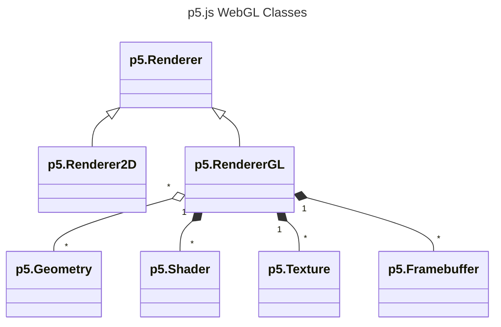
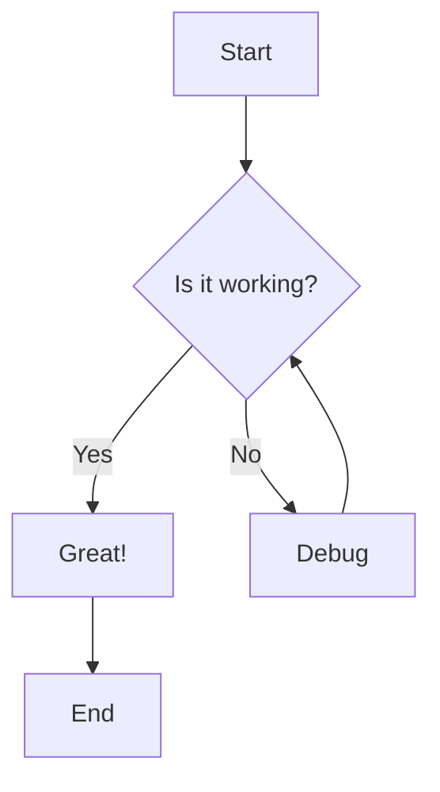
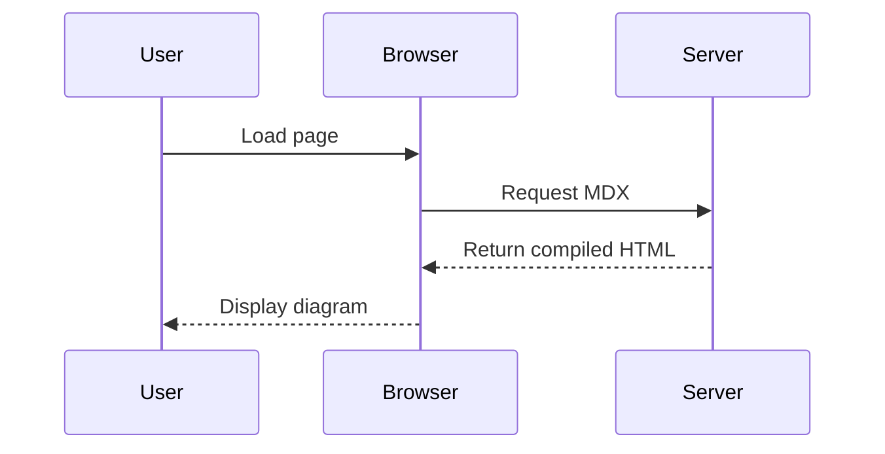
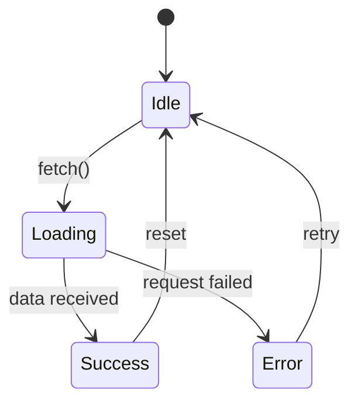

# Mermaid Diagram Test

This page tests the Mermaid diagram rendering functionality.

## Class Diagram (from WebGL Architecture)

This is the actual diagram from `webgl_mode_architecture.mdx`:

## Flowchart Example

## Sequence Diagram Example

## State Diagram Example

## Text After Diagrams

If you can see all the diagrams above rendered as visual graphics (not code), the Mermaid plugin is working correctly!

Try toggling between light and dark mode to verify both themes work.
